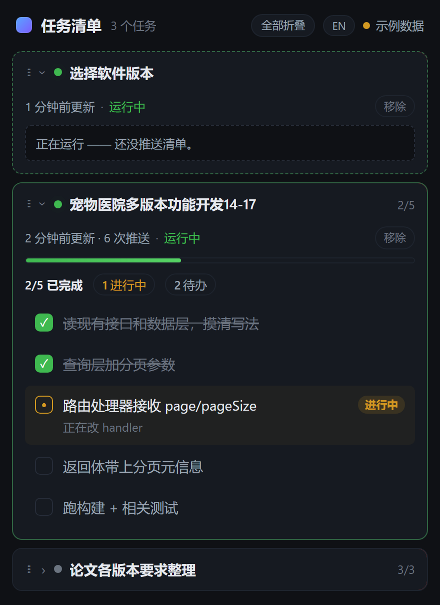
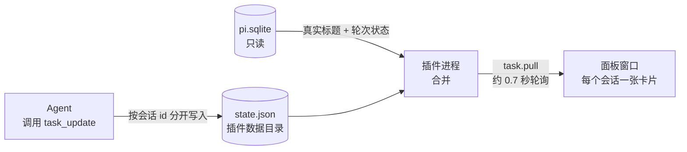

<div align="center">

# Task Panel · 任务清单面板

**给 PI-Desktop 的 Agent 一块实时进度看板**

每个对话一张卡片，标题就是你给对话起的名字；多个任务同时在跑，各看各的进度，互不覆盖。

[](https://github.com/Emotional-Sub/pi-desktop-taskpanel/releases/latest)
[](LICENSE)


[下载最新版](https://github.com/Emotional-Sub/pi-desktop-taskpanel/releases/latest) · [快速开始](#快速开始) · [工作原理](#工作原理) · [更新日志](CHANGELOG.md)

<picture>
  <source media="(prefers-color-scheme: light)" srcset="docs/screenshot-light.png">
  
</picture>

<sub>截图为面板自带的演示数据，会跟随 GitHub 的深色 / 浅色主题切换。</sub>

</div>

## 亮点

| | |
| --- | --- |
| 🏷️ **真实会话名** | 卡片标题直接从本机数据库读取，你改了对话名，面板下一次刷新就跟上。 |
| 🗂️ **多任务并列** | 每个会话一张可折叠卡片，运行中的排在最前，并发的对话互不覆盖。 |
| 📊 **实时状态** | 进度条，加上 已完成 / 进行中 / 待办 / 受阻 计数，以及 运行中 / 完成 / 中止 / 出错 状态。 |
| 🔍 **主动发现** | 正在运行但还没推送清单的会话，也会先显示一张占位卡片。 |
| ⏰ **停更提醒** | 运行中却超过 10 分钟没推进度的卡片会标黄，提醒你 Agent 可能忘了汇报。 |
| ↕️ **拖动排序** | 按住 ⋮⋮ 手柄一口气拖过多张卡片，拖到边缘自动滚动，顺序记在本地。 |
| 👈 **左划删除** | 卡片头向左划出「删除」；删掉的会话在有新动静之前不会再冒出来。 |
| 🌐 **中 / 英界面** | 一键切换界面语言，默认中文，不跟着宿主语言乱跳。 |
| 🔒 **只读、不联网** | 只读打开本机 `pi.sqlite`，不读消息正文、不写库、不联网，零依赖。 |

## 快速开始

1. 从 [Releases](https://github.com/Emotional-Sub/pi-desktop-taskpanel/releases/latest) 下载 `local.taskpanel-<版本号>.piplug`。
2. 在 PI-Desktop 的**插件**页面导入它。升级也一样，直接导入新版本即可。
3. 命令面板运行 **任务清单: 打开面板**（英文界面下是 `Task Panel: Open`）。之后 Agent 一调用 `task_update`，面板会自动弹出。

> [!TIP]
> 不需要改 AGENTS.md。推送纪律写在 `task_update` 的工具描述里，每轮都随工具定义进入模型上下文，装好插件就生效，长会话里也不容易被上下文压缩冲掉。

### 命令

命令面板里搜「任务清单」或「Task Panel」：

| 命令 | 作用 |
| --- | --- |
| 任务清单: 打开面板 · `Open` | 打开或前置面板窗口 |
| 任务清单: 清空全部 · `Clear all` | 移除所有卡片；正在运行的会话要等重新推送清单或开始新一轮才会再出现 |
| 任务清单: 渲染示例 · `Render sample` | 推一份示例清单，看看效果 |

### 面板操作

| 想做的事 | 怎么做 |
| --- | --- |
| 折叠 / 展开一张卡片 | 点卡片头 |
| 全部折叠 / 全部展开 | 右上角「全部折叠」 |
| 调整顺序 | 按住卡片左侧 ⋮⋮ 上下拖；或聚焦 ⋮⋮ 后按 <kbd>↑</kbd> / <kbd>↓</kbd> |
| 回到自动顺序 | 右上角「默认排序」（拖动过才出现） |
| 删除卡片 | 卡片头向左划，点「删除」；或点卡片里的「移除」 |
| 收起露出的删除按钮 | 向右划回去、点卡片以外的地方，或按 <kbd>Esc</kbd> |
| 切换界面语言 | 右上角 `EN` / `中` |

折叠状态、手动顺序和界面语言都保存在面板本地，重开面板仍然有效。新出现的会话会排在最前，方便你注意到。

## 工作原理



- **清单**来自模型。Agent 调 `task_update` 时带上完整清单，插件按这次工具调用所属的会话 id 存进 `state.json`，并发的对话各存各的。
- **标题和状态**来自数据库。插件只读打开 PI-Desktop 本机的 `pi.sqlite`，取各会话的 `sessions.title` 和最新一条 `turns.status`，所以标题永远是真实会话名，改名后自动跟上。
- **面板**轮询 `task.pull`，拿到合并后的结果渲染成卡片。拖动或左划进行中会暂停重渲染，手势结束后再应用新数据。

<details>
<summary><b>为什么读数据库，而不是用宿主的会话 API？</b></summary>

<br>

插件可用的会话 API 是 `pi.session.get`（权限 `session.read.own`），但 "own" 的范围只覆盖插件自己导入的会话，看不到你的真实对话，也就拿不到标题。只读打开 `pi.sqlite` 是同类插件（例如 Session Notify）拿真实标题的通行做法。来龙去脉见 [CHANGELOG 0.4.0](CHANGELOG.md#040)。

</details>

> [!NOTE]
> 进度只在模型调用 `task_update` 时才产生，`pi.sqlite` 和本机任何文件里都没有这类数据，插件没法替模型算出或补推。面板能做的是检测停更、标黄提醒，真正的进度还是要靠会话里的模型推送。

## `task_update` 工具

| 参数 | 类型 | 说明 |
| --- | --- | --- |
| `tasks` | `{ text, status?, note? }[]` | 完整清单，按显示顺序。每次传全量，覆盖本会话的卡片；传空数组则移除卡片 |
| `title` | `string`，可选 | 清单名。只在拿不到真实会话名时显示 |
| `open` | `boolean`，可选，默认 `true` | 是否打开 / 前置面板窗口 |

`status` 取值：`todo`（待办，默认）、`doing`（进行中）、`done`（已完成）、`blocked`（受阻）。`note` 是显示在该项下方的一行补充说明。

```json
{
  "tasks": [
    { "text": "读现有接口和数据层", "status": "done" },
    { "text": "查询层加分页参数", "status": "doing", "note": "正在改 handler" },
    { "text": "跑构建和测试", "status": "todo" },
    { "text": "等待接口密钥", "status": "blocked", "note": "缺测试环境密钥" }
  ]
}
```

单份清单最多 200 项，面板最多同时保留 12 张卡片，超过 3 天没更新的清单会自动清掉。

## 隐私与权限

| | |
| --- | --- |
| **申请的权限** | 只有 `ui.panel`（面板窗口）和 `agent.tool.register`（注册 `task_update`） |
| **读取** | 只读打开本机 `pi.sqlite`，只读会话标题和最新轮次的状态 / 时间戳 |
| **写入** | 只写插件自己的数据目录（`state.json`），以及面板本地存储（折叠、顺序、语言） |
| **从不** | 读消息正文、写数据库、发网络请求、用剪贴板、调 shell |

清单文本只来自模型的 `task_update` 调用，不会离开你的电脑。

## 常见问题

<details>
<summary><b>卡片标题显示的是清单名，不是会话名？</b></summary>

<br>

说明插件这次没读到 `pi.sqlite`。可能是 PI-Desktop 自带的 Node 没有 `node:sqlite`，也可能是数据库暂时打不开。这时面板会退回显示 `task_update` 里的 `title`，不会报错；能读到数据库之后会自动换回真实会话名。

</details>

<details>
<summary><b>进度一直不动？</b></summary>

<br>

进度只在模型调用 `task_update` 时更新。会话还在运行、却超过 10 分钟没推进度的卡片会标黄提醒。这时可以在对话里提醒 Agent 推送一下进度。

</details>

<details>
<summary><b>删掉的卡片又出现了？</b></summary>

<br>

删除后，这个会话在重新推送清单或开始新一轮对话之前都会保持隐藏。它又出现，说明会话有了新动静，这是有意的设计。

</details>

<details>
<summary><b>「正在运行，还没推送清单」是什么卡片？</b></summary>

<br>

这是主动发现的会话：数据库显示它正在运行，但模型还没调用过 `task_update`。只显示最近 30 分钟内有活动的会话，卡死的旧轮次会被过滤掉。

</details>

## 开发

需要 Node.js ≥ 22.13：测试要用内置的 `node:sqlite`，22.13 起不加 `--experimental-sqlite` 也能用。项目没有任何第三方依赖，不用 `npm install`。

```sh
npm test        # 工具逻辑测试 + 面板渲染测试，不需要运行中的 PI-Desktop
npm run pack    # 打包出 dist/local.taskpanel-<版本号>.piplug
```

测试全程在 Node 里跑：mock 掉 `pi` 桥接和 DOM，用 `node:sqlite` 建一个临时的 `pi.sqlite`，验证标题和状态这条链路。

> [!IMPORTANT]
> 渲染测试用的是极简 DOM 桩，没有真实布局、事件冒泡和指针捕获。改了拖动、左划这类手势，请用 Edge 或 Chrome 直接打开 `src/renderer/index.html` 再试一遍：没有宿主桥接时，面板会进入演示模式，显示三张示例卡片。0.5.0 的「不能连续拖动」就只在真实浏览器里出现。

<details>
<summary><b>目录结构</b></summary>

```
src/
  manifest.json        插件清单（id、权限、工具和命令声明）
  main.js              插件进程：task_update 工具、state.json、pi.sqlite 读取
  renderer/
    index.html         面板结构
    panel.css          面板样式（深色优先，浅色走 prefers-color-scheme）
    panel.js           面板逻辑：轮询、合并、手风琴渲染、折叠、拖动排序、左划删除、中 / 英切换
scripts/
  pack.js              打包成 STORED 模式的 .piplug（无外部依赖）
test/
  test-taskpanel.js    main.js 逻辑（会话隔离、sqlite 标题/状态、主动发现、删除后不回弹、降级）
  test-render.js       panel.js 渲染（卡片、折叠、状态、实时重渲染、语言切换、拖动 / 左划手势）
docs/
  screenshot-*.png     README 截图（深色 / 浅色）
```

</details>

<details>
<summary><b>发布新版本</b></summary>

1. 同步改三处版本号：`package.json`、`src/manifest.json`、`src/main.js` 里的 `PLUGIN_VERSION`。
2. 在 `CHANGELOG.md` 顶部加一节新版本。
3. `npm test` 通过后 `npm run pack`。
4. 提交并推送，然后在 GitHub 新建 Release：标签用 `v<版本号>`，附件上传 `dist/` 里的 `.piplug`。

</details>

## 许可证

[MIT](LICENSE)
